Modul `account` menyediakan aplikasi **Invoicing** (dasar). Fitur akuntansi penuh (rekonsiliasi bank lanjutan, laporan keuangan lengkap) ditambahkan oleh modul Enterprise `accountant`.

```mermaid
flowchart LR
    subgraph DEP["Dependensi (depends)"]
        direction TB
        base_setup
        onboarding
        product
        analytic
        portal
        digest
    end

    ACC(["account<br/>Invoicing & Accounting"])

    subgraph EXT["Modul yang memakai / memperluas account"]
        direction TB
        account_payment["account_payment<br/>Bayar online invoice"]
        l10n["l10n_*<br/>Chart of accounts & pajak per negara<br/>(mis. l10n_id)"]
        sale["sale"]
        purchase["purchase"]
        pos["point_of_sale"]
        stock_account["stock_account<br/>Valuasi stok"]
        edi["account_edi_ubl_cii<br/>e-Invoice (UBL, Factur-X)"]
        hr_expense["hr_expense"]
    end

    DEP --> ACC
    ACC --> EXT
```

---

_Sumber: dokumentasi_accounting_odoo.md §1_
