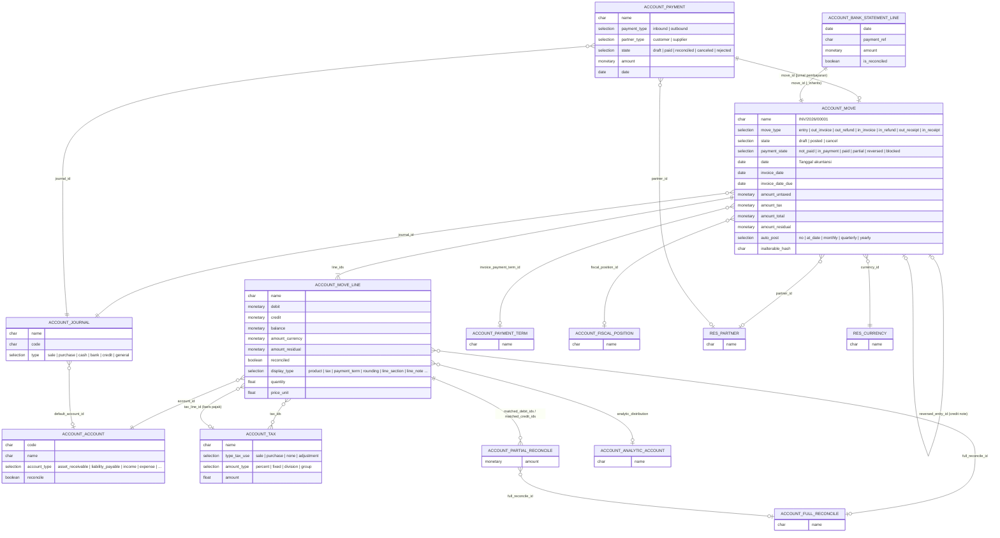

**Model wizard (TransientModel) utama:**

| Model | File | Fungsi |
|---|---|---|
| `account.payment.register` | `wizard/account_payment_register.py` | Register Payment dari invoice/bill |
| `account.move.reversal` | `wizard/account_move_reversal.py` | Credit note / reverse entry |
| `account.move.send.wizard` | `wizard/account_move_send_wizard.py` | Kirim & cetak invoice (email, PDF, e-Invoice) |
| `account.secure.entries.wizard` | `wizard/account_secure_entries_wizard.py` | Hash/kunci entri (inalterability) |
| `account.automatic.entry.wizard` | `wizard/account_automatic_entry_wizard.py` | Ubah periode / akun secara otomatis |
| `validate.account.move` | `wizard/account_validate_account_move.py` | Posting massal |

---

_Sumber: dokumentasi_accounting_odoo.md §2_
