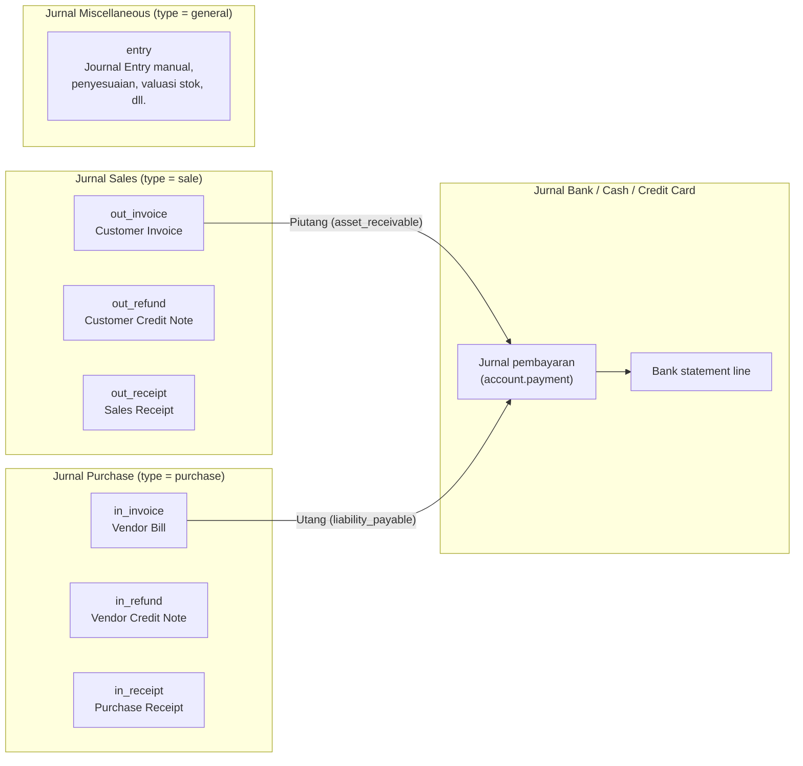

Semua dokumen akuntansi adalah `account.move`. Jenisnya ditentukan oleh `move_type`, dan setiap dokumen dicatat di sebuah jurnal.

**Tipe akun (`account_type`)** dikelompokkan menjadi: Aset (`asset_receivable`, `asset_cash`, `asset_current`, `asset_non_current`, `asset_prepayments`, `asset_fixed`), Liabilitas (`liability_payable`, `liability_credit_card`, `liability_current`, `liability_non_current`), Ekuitas (`equity`, `equity_unaffected`), Pendapatan (`income`, `income_other`), Beban (`expense`, `expense_other`, `expense_depreciation`, `expense_direct_cost`), dan `off_balance`.

---

_Sumber: dokumentasi_accounting_odoo.md §3_
