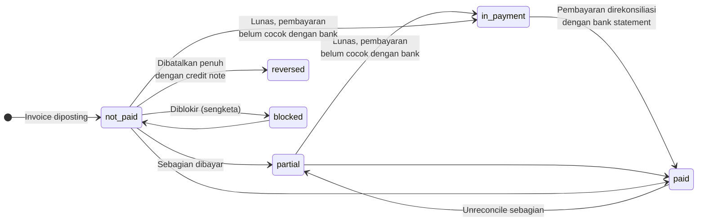

`in_payment` hanya terlihat jika modul `accountant` terpasang (`_get_invoice_in_payment_state()`). Di Invoicing saja, invoice yang lunas langsung menjadi `paid`.

---

_Sumber: dokumentasi_accounting_odoo.md §5_
