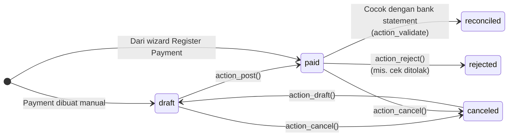

Pilihan di wizard **Register Payment**: bayar penuh atau sebagian, *Keep open* atau *Mark as fully paid* (selisih dicatat sebagai write-off), *Group payments* untuk banyak invoice dari partner yang sama, serta pembayaran dengan mata uang berbeda (selisih kurs dicatat lewat exchange difference entry).

---

_Sumber: dokumentasi_accounting_odoo.md §7_
