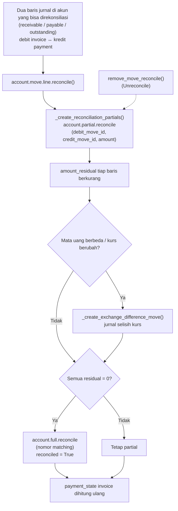

**Reconciliation model** (`account.reconcile.model`) membantu rekonsiliasi bank, dengan dua jenis (`rule_type`): `reco_model` (model write-off/counterpart yang diterapkan manual) dan `matching_rule` (cocokkan otomatis dengan invoice/payment).

---

_Sumber: dokumentasi_accounting_odoo.md §8_
