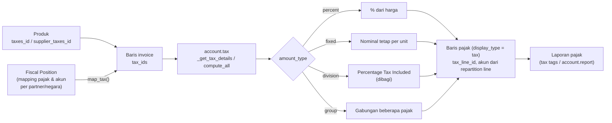

Pengaturan *price include* per pajak menentukan apakah harga produk sudah termasuk pajak. Cash rounding (`account.cash.rounding`) bisa menambah baris pembulatan.

---

_Sumber: dokumentasi_accounting_odoo.md §10_
