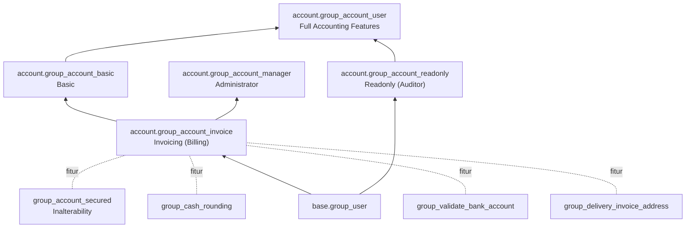

| Grup | Hak |
|---|---|
| Invoicing | Buat & posting invoice/bill, register payment |
| Readonly | Lihat semua data akuntansi tanpa mengubah |
| Full Accounting Features | Fitur akuntansi lengkap (jurnal, rekonsiliasi, laporan) |
| Administrator | Konfigurasi (chart of accounts, pajak, jurnal, lock date). Secara teknis hanya mewarisi grup Invoicing; untuk fitur akuntansi lengkap biasanya juga diberi Full Accounting Features |

---

_Sumber: dokumentasi_accounting_odoo.md §13_
