Modul CRM dibangun di atas `sales_team` (tim penjualan) dan `mail` (chatter, aktivitas, email gateway). Banyak modul lain yang memperluas CRM, misalnya `sale_crm` (quotation dari opportunity) dan `website_crm` (form kontak website).

```mermaid
flowchart LR
    subgraph DEP["Dependensi (depends)"]
        direction TB
        base_setup
        sales_team
        mail
        calendar
        resource
        utm
        contacts
        digest
        phone_validation
        web_tour
        base_install_request
    end

    CRM(["crm<br/>Track leads & close opportunities"])

    subgraph EXT["Modul yang memperluas CRM"]
        direction TB
        sale_crm["sale_crm<br/>Quotation dari opportunity"]
        website_crm["website_crm<br/>Form kontak → lead"]
        crm_livechat["crm_livechat<br/>Livechat → lead"]
        crm_iap_mine["crm_iap_mine<br/>Generate leads (IAP)"]
        crm_iap_enrich["crm_iap_enrich<br/>Enrich data perusahaan"]
        crm_sms["crm_sms"]
        mass_mailing_crm["mass_mailing_crm"]
        event_crm["event_crm<br/>Peserta event → lead"]
        survey_crm["survey_crm"]
        website_crm_partner_assign["website_crm_partner_assign<br/>Lead ke reseller"]
        crm_mail_plugin["crm_mail_plugin"]
    end

    DEP --> CRM
    CRM --> EXT
```

---

_Sumber: dokumentasi_crm_odoo.md §1_
