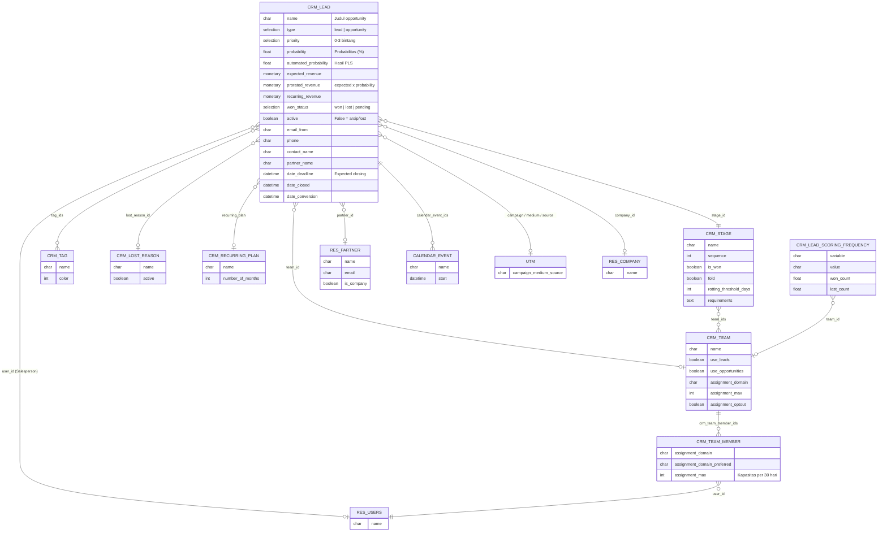

Model utama adalah `crm.lead`, yang menyimpan **lead** maupun **opportunity** (dibedakan oleh field `type`).

**Model wizard (TransientModel):**

| Model | File | Fungsi |
|---|---|---|
| `crm.lead2opportunity.partner.mass` | `wizard/crm_lead_to_opportunity_mass.py` | Konversi massal (Convert / Convert & Merge) |
| `crm.merge.opportunity` | `wizard/crm_merge_opportunities.py` | Menggabungkan lead/opportunity duplikat |
| `crm.lead.lost` | `wizard/crm_lead_lost.py` | Menandai lost + alasan |
| `crm.lead.pls.update` | `wizard/crm_lead_pls_update.py` | Pengaturan field & tanggal mulai PLS |

---

_Sumber: dokumentasi_crm_odoo.md §2_
