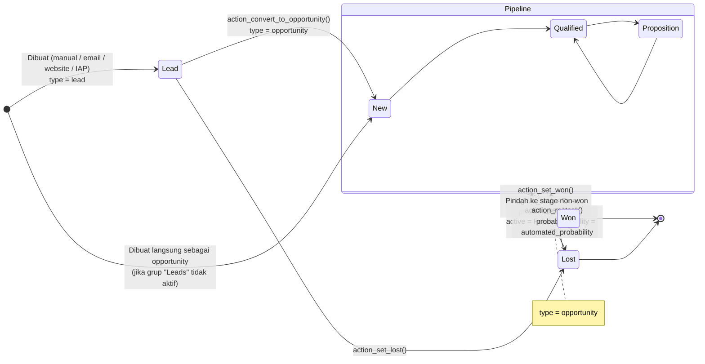

Status *won/lost* dihitung di field `won_status`:

- **Won** = lead berada di stage dengan `is_won = True` (probabilitas 100%).
- **Lost** = `active = False` **dan** `probability = 0`.
- **Pending** = selain itu.

Stage bawaan (`data/crm_stage_data.xml`): **New (1) → Qualified (2) → Proposition (3) → Won (70)**.

---

_Sumber: dokumentasi_crm_odoo.md §3_
