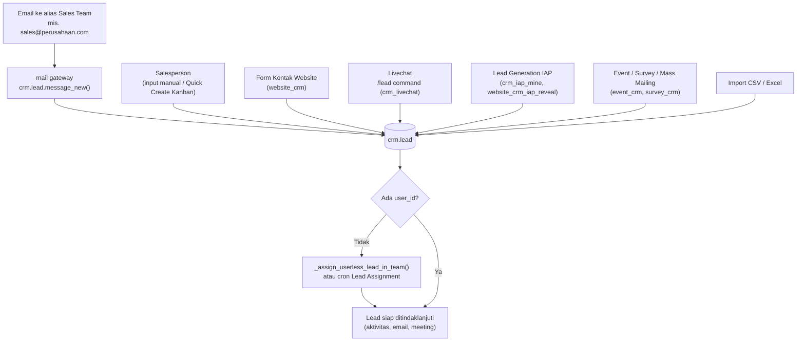

Pada `message_new()`, default salesperson **dikosongkan** (`default_user_id=False`) agar penugasan dilakukan oleh aturan otomatis, bukan oleh user gateway (root). Nama lead diambil dari subjek email, `email_from` dari pengirim.

---

_Sumber: dokumentasi_crm_odoo.md §4_
