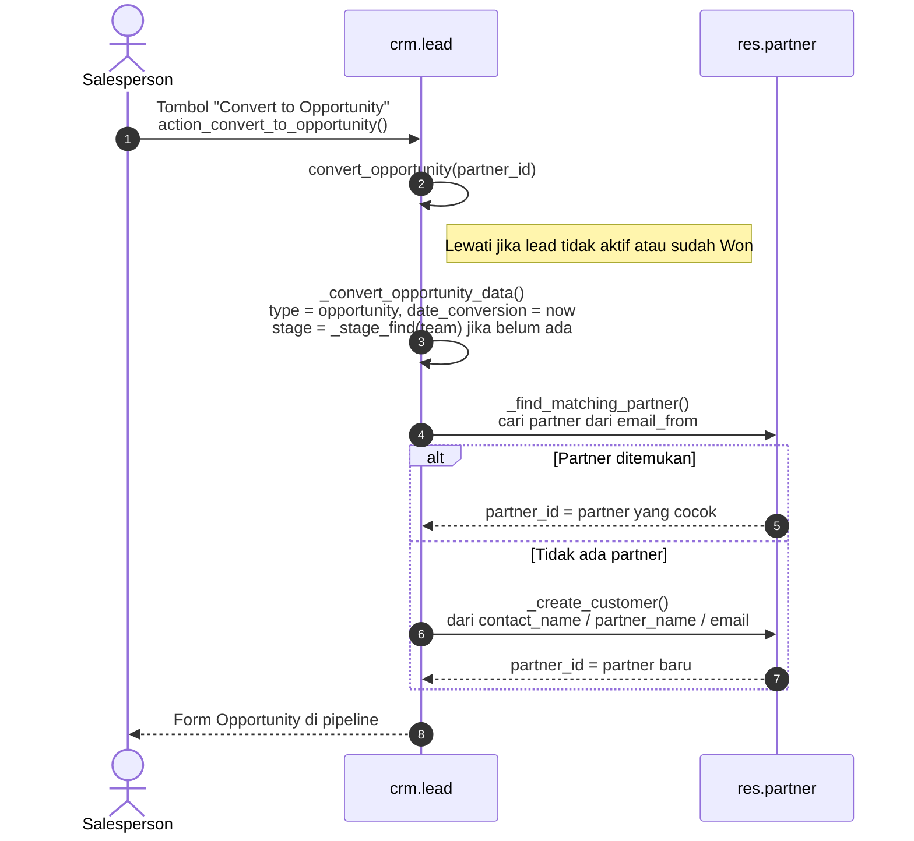
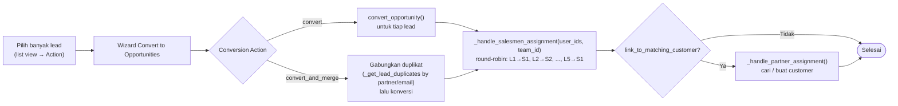

Di Odoo 20.0 konversi **satu lead** dilakukan langsung lewat tombol *Convert to Opportunity* (`action_convert_to_opportunity()`), tanpa wizard. Konversi **banyak lead** memakai wizard `crm.lead2opportunity.partner.mass`.

**Konversi massal** (`crm.lead2opportunity.partner.mass`):

---

_Sumber: dokumentasi_crm_odoo.md §5_
