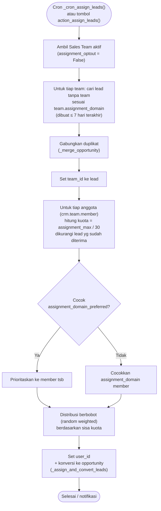

Diaktifkan di **CRM → Configuration → Settings → Rule-Based Assignment**. Bisa manual (tombol *Assign Leads*) atau otomatis via cron **"CRM: Lead Assignment"** (`crm.team._cron_assign_leads()`, default tiap 1 hari).

Aturan member (`assignment_rules`): **Always in rotation**, **In rotation, with a limit**, **Out of rotation**.

---

_Sumber: dokumentasi_crm_odoo.md §7_
