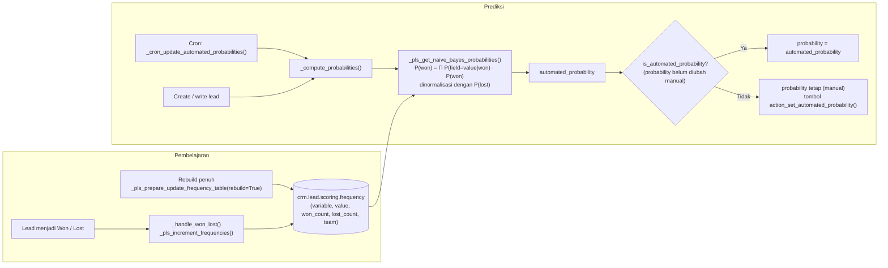

Probabilitas otomatis dihitung dengan **Naive Bayes** berdasarkan histori lead won/lost per Sales Team. Field yang dipakai secara default: `stage_id`, `state_id`, `country_id`, `phone_state`, `email_state`, `source_id`, `lang_id`, `tag_ids` (dapat diatur via wizard `crm.lead.pls.update`).

Nilai 0.1 ditambahkan pada `won_count`/`lost_count` untuk menghindari frekuensi nol.

---

_Sumber: dokumentasi_crm_odoo.md §8_
