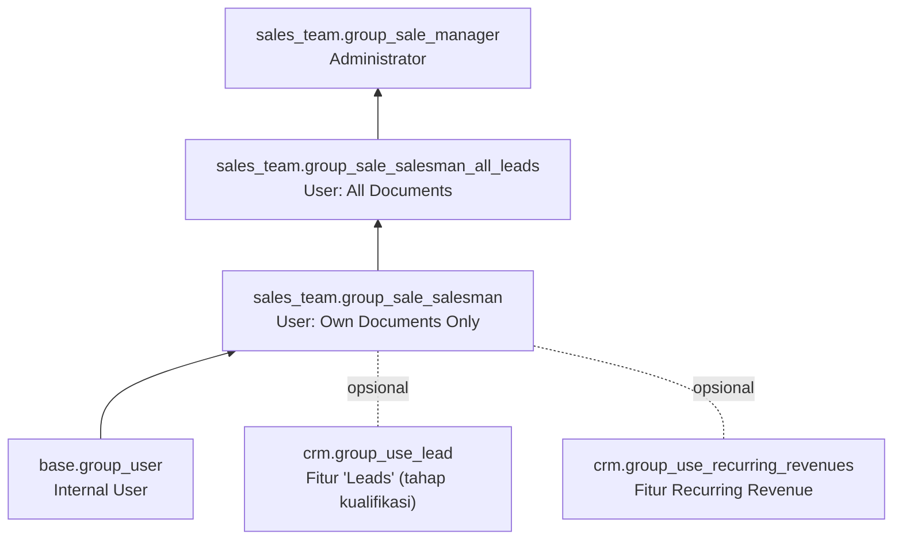

CRM memakai grup dari `sales_team`:

| Grup | Akses ke `crm.lead` |
|---|---|
| Own Documents Only | Baca/tulis/buat lead miliknya sendiri atau yang belum ada salesperson (tanpa hapus) |
| All Documents | Baca/tulis/buat semua lead (tanpa hapus) |
| Administrator | CRUD semua lead + konfigurasi (stage, team, tag, lost reason, PLS) |

Semua grup juga dibatasi aturan multi-company: `company_id in company_ids + [False]`.

---

_Sumber: dokumentasi_crm_odoo.md §10_
