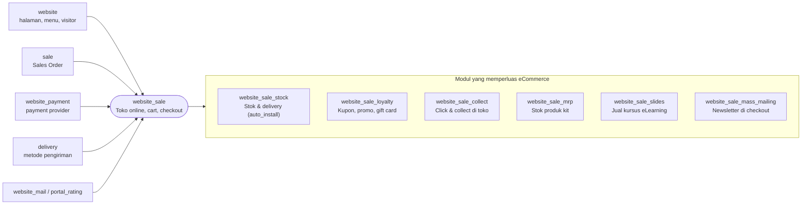

`website_sale` bergantung pada `website`, `sale`, `website_payment`, `website_mail`, `portal_rating`, `digest`, `delivery`, dan `html_builder`. Order online adalah **Sales Order biasa** dengan `website_id` terisi.

---

_Sumber: dokumentasi_website_sale_odoo.md §1_
