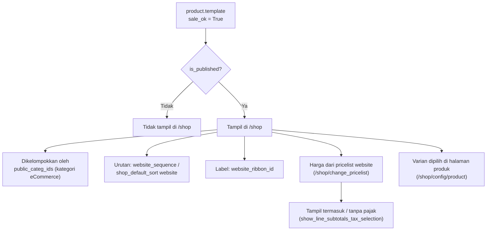

Halaman utama: `/shop` (daftar produk, filter, pencarian), `/shop/<product>` (detail produk), `/shop/compare` (perbandingan), `/shop/wishlist` (wishlist).

---

_Sumber: dokumentasi_website_sale_odoo.md §3_
