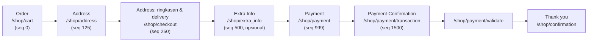

Urutan langkah disimpan di model `website.checkout.step` (`website_sale/data/website_checkout_step_data.xml`), sehingga bisa disesuaikan per website.

- **Akun pelanggan** (`account_on_checkout`): `optional` (boleh guest), `disabled` (selalu guest), `mandatory` (wajib login).
- **Extra Info** hanya tampil jika view `website_sale.extra_info` aktif.
- **Pengiriman**: daftar metode dari `/shop/delivery_methods`, harga dari `/shop/get_delivery_rate`, dipilih via `/shop/set_delivery_method` (modul `delivery`).
- **Express checkout** (`/shop/express_checkout`): alamat & pembayaran langsung dari dompet digital (Google Pay/Apple Pay, tergantung provider).

---

_Sumber: dokumentasi_website_sale_odoo.md §5_
