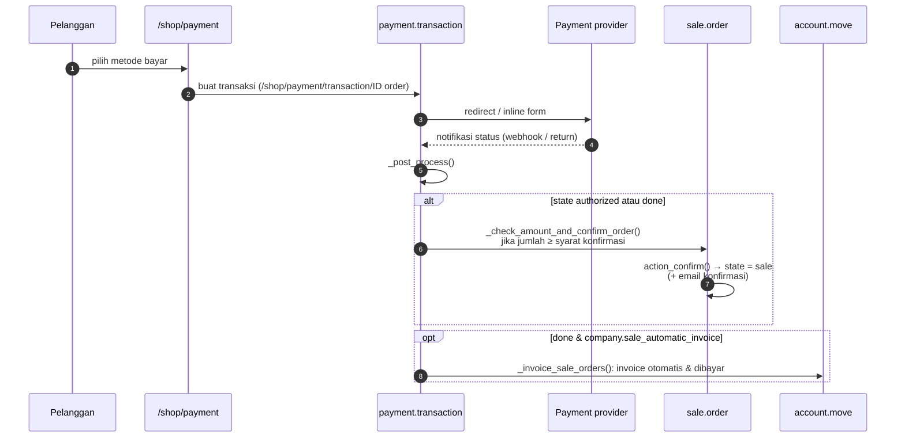

Konfirmasi hanya terjadi bila **tepat satu** quotation terkait transaksi dan `_is_confirmation_amount_reached()` terpenuhi (mendukung prepayment sebagian, lihat dokumentasi Sales).

---

_Sumber: dokumentasi_website_sale_odoo.md §6_
