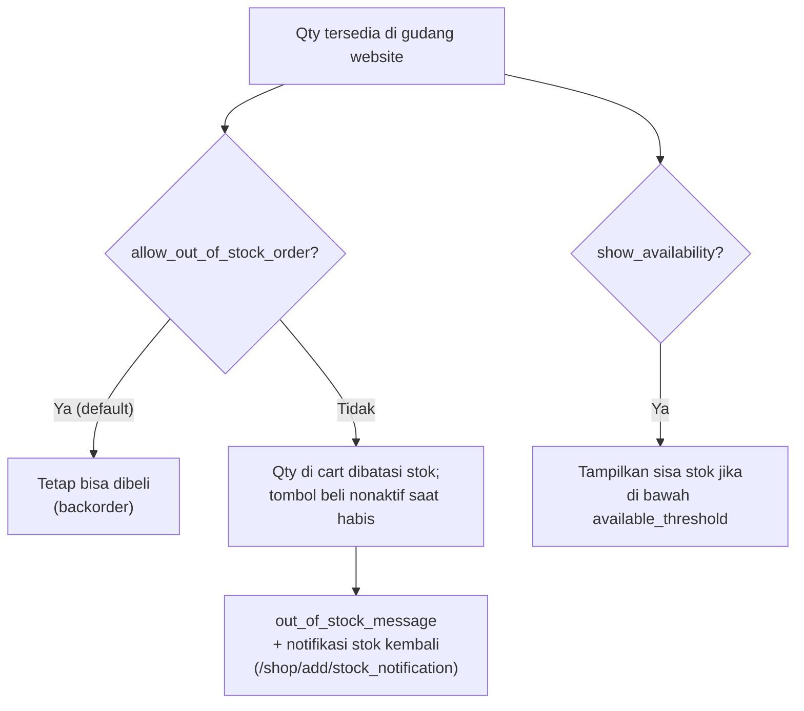

Field stok ada di `product.template` (`website_sale`); pengecekan stok aktual dilakukan oleh `website_sale_stock` (auto install bila `stock` terpasang).

---

_Sumber: dokumentasi_website_sale_odoo.md §8_
