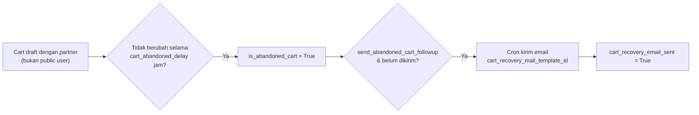

**Cron** (`website_sale/data/ir_cron_data.xml`):

| Nama | Fungsi |
|---|---|
| eCommerce: send email to customers about their abandoned cart | Email pemulihan cart |
| eCommerce: send order rating request emails | Minta rating setelah order (`send_order_rating_emails`) |
| eCommerce: Update suggested products | Perbarui rekomendasi produk |
| Product: send email regarding products availability | Notifikasi produk tersedia kembali |

---

_Sumber: dokumentasi_website_sale_odoo.md §9_
