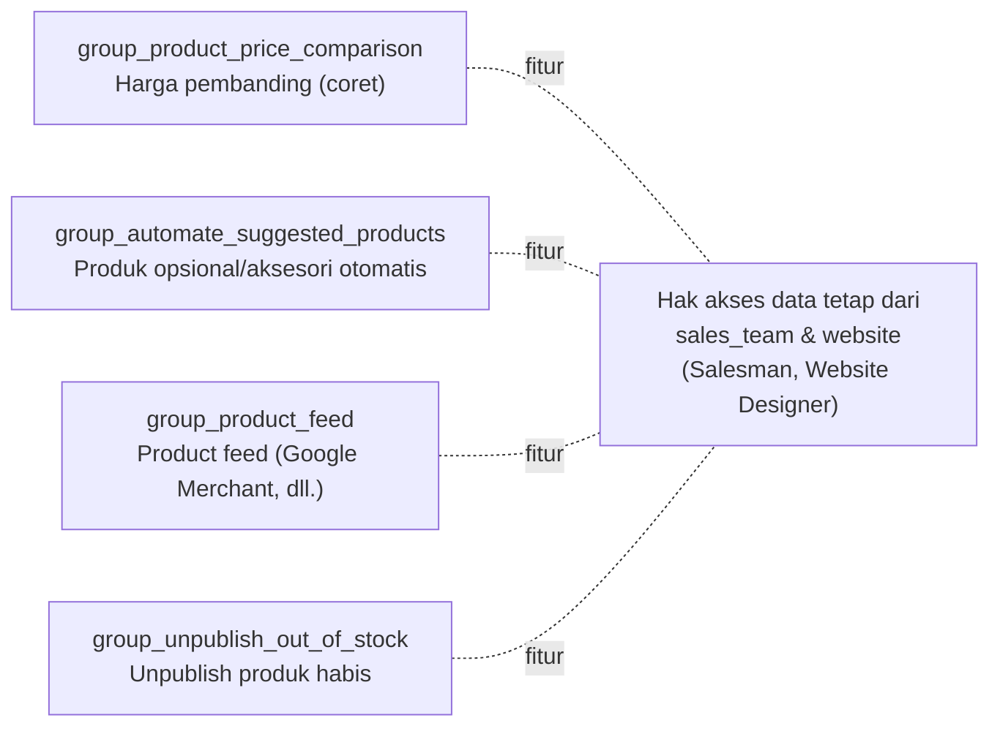

| Pengaturan | Field |
|---|---|
| Akses toko | `ecommerce_access`: `everyone` / `logged_in` |
| Akun pelanggan | `account_on_checkout` |
| Sembunyikan tombol beli | `prevent_sale`, `prevent_sale_for` |
| Pricelist default | `website.pricelist_id` |
| Jual saat stok habis (default produk baru) | `default_allow_out_of_stock_order` |
| Tampilkan stok | `default_show_availability`, `default_available_threshold` |
| Salesperson & tim | `website.salesperson_id`, `website.salesteam_id` |

**Grup fitur** (`website_sale/security/res_groups.xml`):

---

_Sumber: dokumentasi_website_sale_odoo.md §10_
