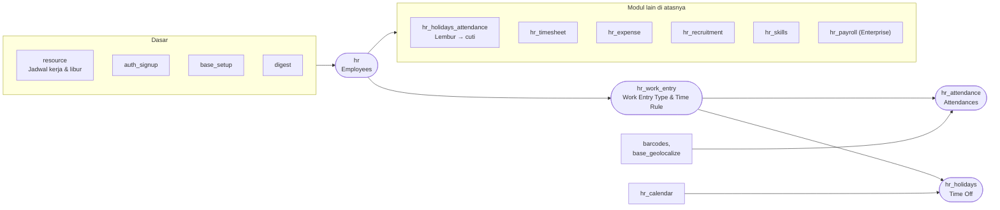

Perubahan besar di Odoo 20.0:

- **`hr.contract` tidak ada lagi.** Data kontrak (tanggal kontrak, gaji, jadwal kerja, tipe karyawan) disimpan di **`hr.version`**, yaitu riwayat versi data karyawan per tanggal efektif.
- **`hr.leave.type` tidak ada lagi.** Jenis cuti adalah **`hr.work.entry.type`** (dari `hr_work_entry`) yang diberi pengaturan time off.
- **`hr.time.rule`** (di `hr_work_entry`) adalah aturan umum untuk lembur/kurang jam, dipakai bersama oleh Attendances dan Time Off.

---

_Sumber: dokumentasi_hr_odoo.md §1_
