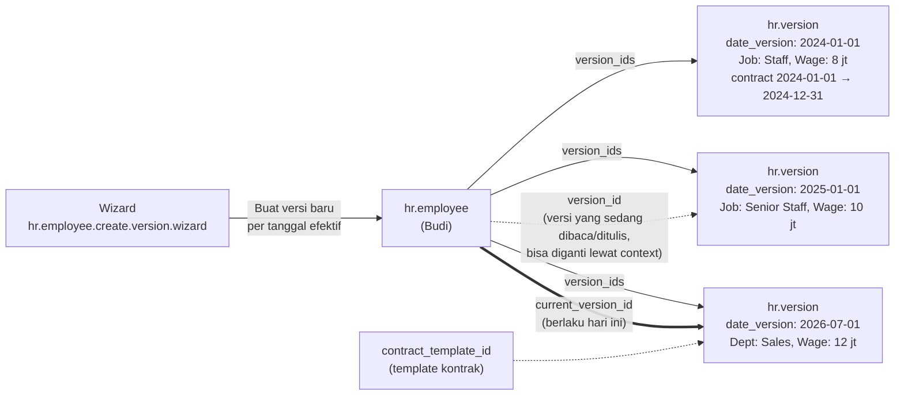

`hr.employee` memakai **`_inherits = {'hr.version': 'version_id'}`**. Field seperti departemen, jabatan, jadwal kerja, gaji, tanggal kontrak, dan data pribadi dibaca/ditulis ke versi yang aktif. Setiap perubahan bisa disimpan sebagai **versi baru dengan tanggal efektif**, sehingga riwayatnya tidak hilang.

---

_Sumber: dokumentasi_hr_odoo.md §3_
