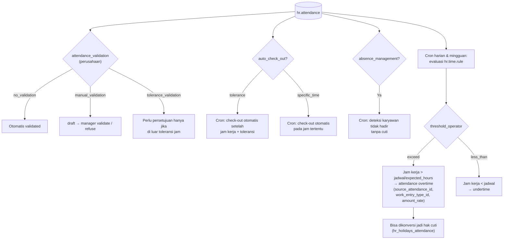

Time rule bisa dibatasi per hari (Senin–Minggu, hari libur), jam (`timing_start`–`timing_stop`), karyawan (`employee_domain`), dan negara. Toleransi bisa dibedakan untuk karyawan (`employee_tolerance`) dan perusahaan (`employer_tolerance`).

---

_Sumber: dokumentasi_hr_odoo.md §7_
