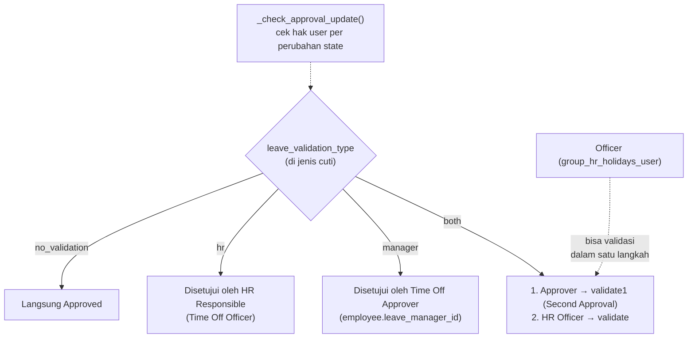

Hari wajib masuk (`hr.leave.mandatory.day`) bisa diatur agar karyawan tidak bisa mengajukan cuti pada tanggal tersebut. Libur nasional bisa diimpor lewat wizard `load.public.holiday.wizard` atau dibuat otomatis oleh cron.

---

_Sumber: dokumentasi_hr_odoo.md §11_
