```mermaid
flowchart LR
    subgraph DEP["Dependensi (depends)"]
        direction TB
        product
        barcodes_gs1_nomenclature
        digest
    end

    STOCK(["stock<br/>Inventory"])

    subgraph EXT["Modul yang memperluas Inventory"]
        direction TB
        stock_account["stock_account<br/>Valuasi stok & jurnal"]
        sale_stock["sale_stock<br/>Delivery dari Sales Order"]
        purchase_stock["purchase_stock<br/>Receipt dari Purchase Order"]
        pos_stock["pos_stock<br/>Picking dari order POS"]
        mrp["mrp<br/>Konsumsi & hasil produksi"]
        stock_dropshipping["stock_dropshipping"]
        stock_landed_costs["stock_landed_costs"]
        stock_delivery["delivery / stock_delivery<br/>Kurir & ongkir"]
        quality["stock_barcode, quality, dll."]
    end

    DEP --> STOCK
    STOCK --> EXT
```

Catatan versi 20.0:

- **Batch & wave transfer** (`stock.picking.batch`) sudah ada di modul `stock`.
- **`procurement.group` digantikan oleh `stock.reference`**, yang menghubungkan dokumen asal (SO/PO) dengan move-nya.
- **Scrap** tidak lagi berupa model `stock.scrap`, melainkan `stock.move` dengan `is_scrap = True` dan tag alasan (`stock.scrap.reason.tag`).

---

_Sumber: dokumentasi_inventory_odoo.md §1_
