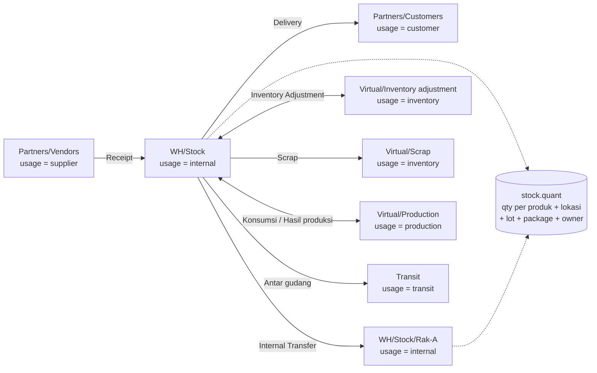

Odoo memakai **double-entry inventory**: setiap pergerakan barang adalah perpindahan dari satu lokasi ke lokasi lain. Stok tidak pernah "muncul" atau "hilang", hanya berpindah antar lokasi (termasuk lokasi virtual).

- **`stock.quant`** hanya ada untuk lokasi `internal` (dan `transit`): ini adalah stok fisik.
- **`stock.move`** = rencana/perpindahan per produk. **`stock.move.line`** = detail aktual (lokasi spesifik, lot/serial, package).

---

_Sumber: dokumentasi_inventory_odoo.md §2_
