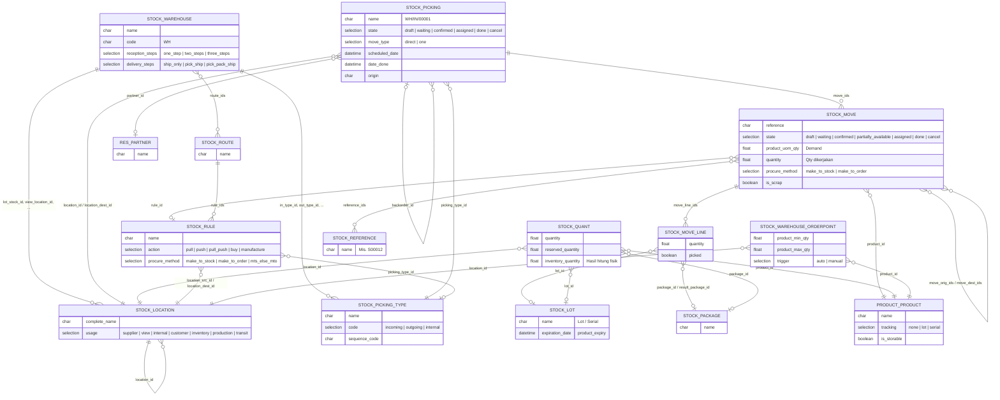

**Model pendukung:** `stock.putaway.rule` (aturan penempatan barang masuk), `product.removal` (strategi pengambilan: FIFO, LIFO, Closest Location, Least Packages, dan FEFO dari `product_expiry`), `stock.storage.category`, `stock.package.type`, `stock.picking.batch` (batch/wave).

---

_Sumber: dokumentasi_inventory_odoo.md §3_
