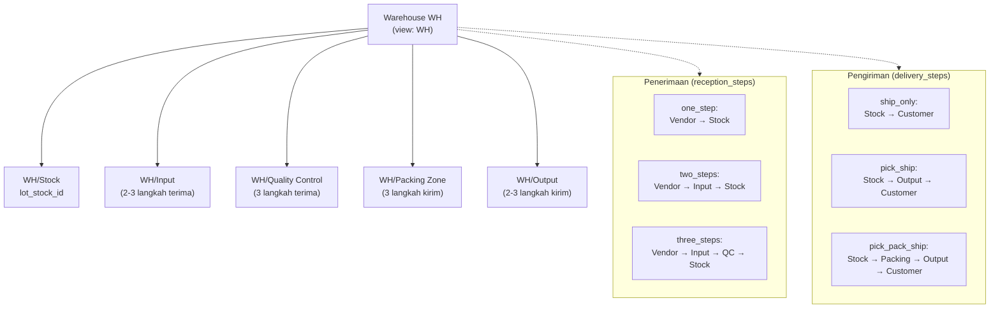

Saat warehouse dibuat, Odoo otomatis membuat lokasi, operation type, route, dan rule sesuai jumlah langkah penerimaan dan pengiriman.

Operation type yang dibuat: **Receipts** (`incoming`), **Delivery Orders** (`outgoing`), **Internal Transfers**, **Pick**, **Pack**, **Storage**, **Quality Control**, dll. sesuai konfigurasi.

---

_Sumber: dokumentasi_inventory_odoo.md §4_
