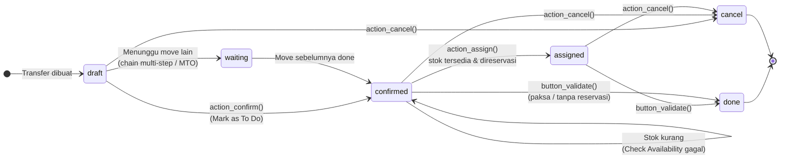

| State picking | Label | Arti |
|---|---|---|
| `draft` | Draft | Belum dikonfirmasi |
| `waiting` | Waiting Another Operation | Menunggu transfer lain selesai |
| `confirmed` | Waiting | Menunggu stok tersedia |
| `assigned` | Ready | Stok sudah direservasi, siap diproses |
| `done` | Done | Selesai, quant sudah diperbarui |
| `cancel` | Cancelled | Dibatalkan |

`stock.move` punya state tambahan **`partially_available`**. Kebijakan pengiriman (`move_type`): **direct** = kirim sebagian dengan backorder, **one** = kirim saat semua produk siap.

---

_Sumber: dokumentasi_inventory_odoo.md §5_
