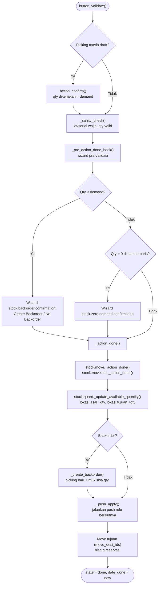

**Reservasi** (`action_assign` → `stock.move._action_assign`): menaikkan `reserved_quantity` di quant sesuai **removal strategy** lokasi/kategori produk (FIFO, LIFO, Closest, Least Packages, FEFO).

---

_Sumber: dokumentasi_inventory_odoo.md §6_
