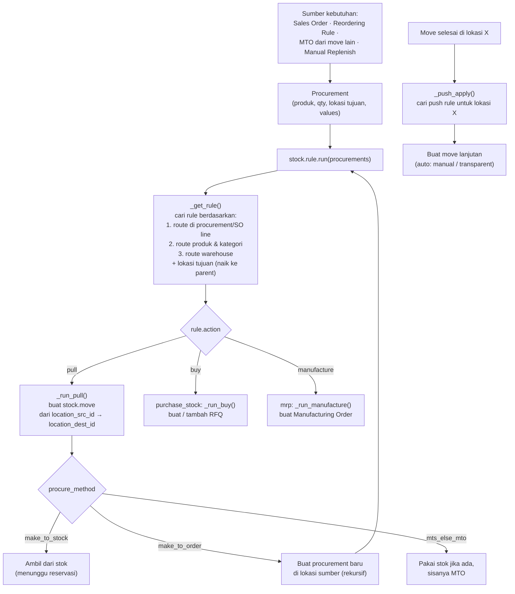

Kebutuhan barang (dari SO, orderpoint, MTO, dll.) dinyatakan sebagai **procurement**, lalu `stock.rule.run()` mencari rule yang cocok dan menjalankannya.

---

_Sumber: dokumentasi_inventory_odoo.md §7_
