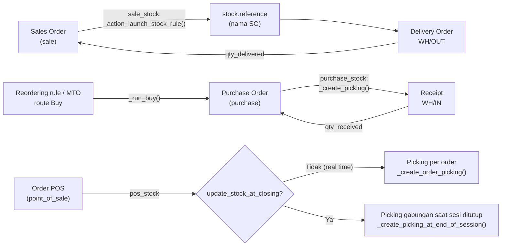

Di `pos_stock`, picking tetap dibuat real time (walau `update_stock_at_closing` aktif) untuk order yang di-invoice pada perusahaan dengan anglo-saxon accounting, atau refund dari order yang dikirim belakangan.

---

_Sumber: dokumentasi_inventory_odoo.md §10_
