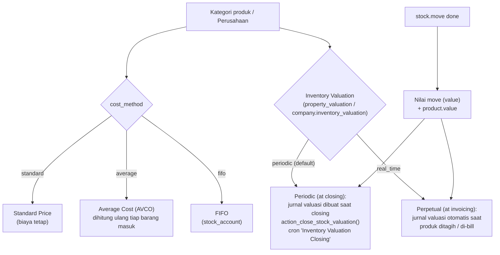

Akun yang dipakai: **Stock Valuation Account**, **Stock Journal**, dan akun selisih harga (*price difference*) dari kategori produk atau default perusahaan.

---

_Sumber: dokumentasi_inventory_odoo.md §11_
