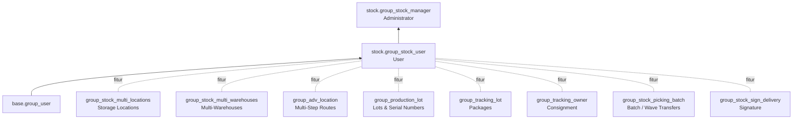

**Cron:**

| Nama | Model | Interval | Fungsi |
|---|---|---|---|
| Procurement: run scheduler | `stock.rule` | 1 hari | Jalankan reordering rule otomatis & reservasi ulang move |
| Account: Inventory Valuation Closing | `res.company` (modul `account`) | — | Jurnal valuasi periodik (`_cron_post_stock_valuation`) |

**Grup akses & fitur:**

---

_Sumber: dokumentasi_inventory_odoo.md §12_
