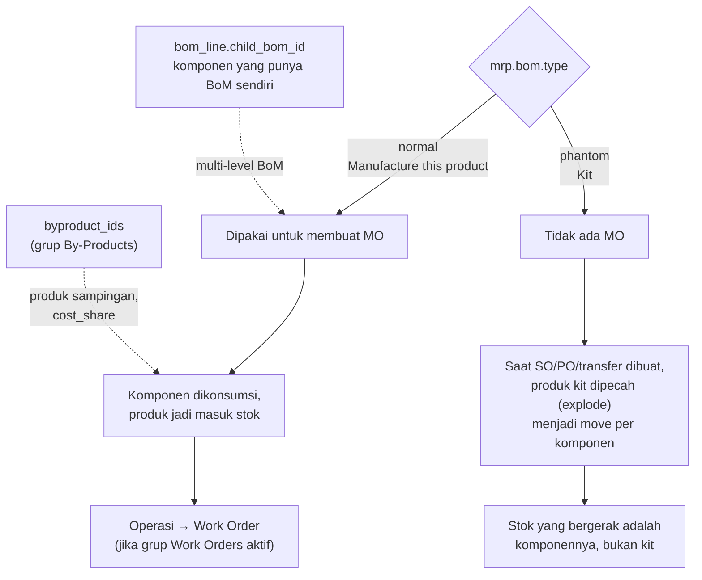

Field `type` di `mrp.bom` menentukan perilaku BoM.

**Pemilihan BoM:** `mrp.bom._bom_find()` mencari BoM yang cocok dengan varian produk, perusahaan, dan (jika diisi) `picking_type_id`. BoM khusus varian (`product_id` terisi) didahulukan dari BoM template.

---

_Sumber: dokumentasi_mrp_odoo.md §3_
