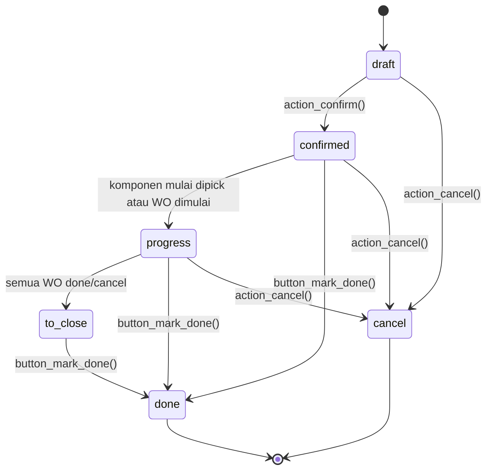

`state` dihitung otomatis (`_compute_state`) dari status move dan work order.

**Kesiapan bahan** (`reservation_state`, terpisah dari `state`):

| Nilai | Arti |
|---|---|
| `confirmed` | Waiting: komponen belum tersedia |
| `assigned` | Ready: komponen tersedia (semua, atau operasi pertama jika `ready_to_produce = asap`) |
| `waiting` | Waiting Another Operation: menunggu transfer sebelumnya (mis. pick komponen) |

---

_Sumber: dokumentasi_mrp_odoo.md §4_
