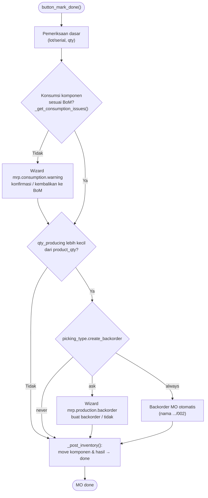

**Fitur lain di MO:**

| Aksi | Method / wizard | Fungsi |
|---|---|---|
| Ubah jumlah | `change.production.qty` | Mengubah `product_qty` MO yang sudah dikonfirmasi |
| Split | `action_split()` → `mrp.production.split` | Memecah MO menjadi beberapa MO |
| Merge | `action_merge()` | Menggabungkan MO dengan produk & BoM sama |
| Lock/Unlock | `action_toggle_is_locked()` | Kunci qty setelah done (default terkunci kecuali grup *Unlocked by default*) |
| Nomor seri massal | `mrp.production.serial.numbers` | Generate serial untuk produk jadi |
| Generate BoM | `action_generate_bom()` | Membuat BoM dari MO tanpa BoM |

---

_Sumber: dokumentasi_mrp_odoo.md §7_
