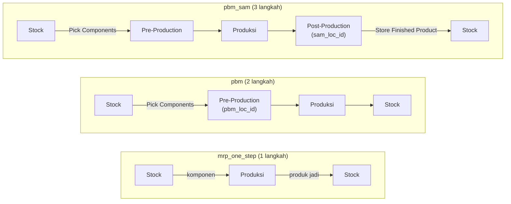
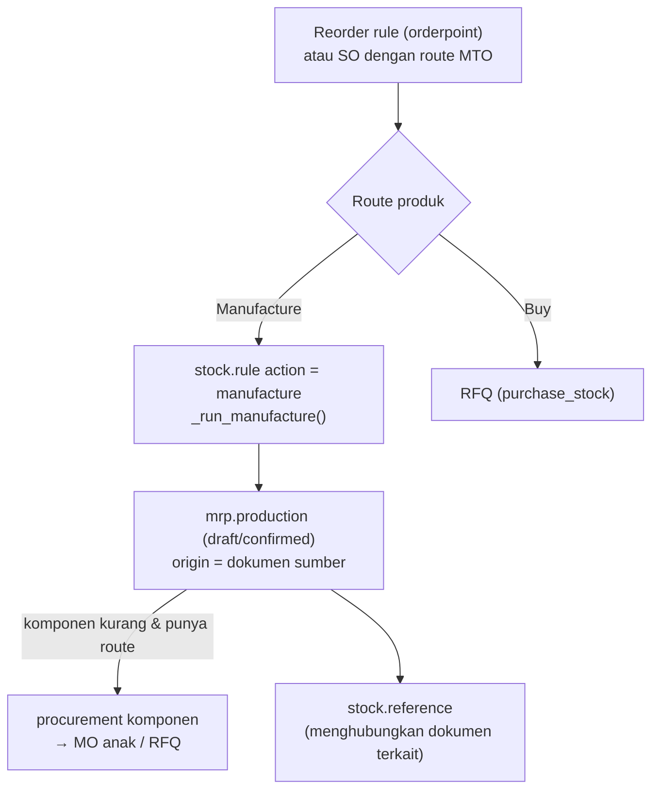

Field `manufacture_steps` di `stock.warehouse`:

Lead time: `produce_delay` (lama produksi) dan `days_to_prepare_mo` (waktu persiapan) di BoM dipakai untuk menghitung tanggal mulai MO.

---

_Sumber: dokumentasi_mrp_odoo.md §8_
