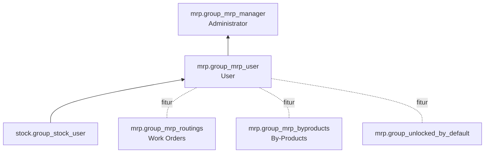

**Pengaturan** (`res.config.settings`):

| Opsi | Field / grup |
|---|---|
| Work Orders | `group_mrp_routings` → `mrp.group_mrp_routings` |
| By-Products | `group_mrp_byproducts` → `mrp.group_mrp_byproducts` |
| Unlock MO secara default | `group_unlocked_by_default` → `mrp.group_unlocked_by_default` |
| MPS, PLM, Quality | `module_mrp_mps`, `module_mrp_plm`, `module_quality_control` (Enterprise) |
| Subcontracting | `module_mrp_subcontracting` |

---

_Sumber: dokumentasi_mrp_odoo.md §11_
