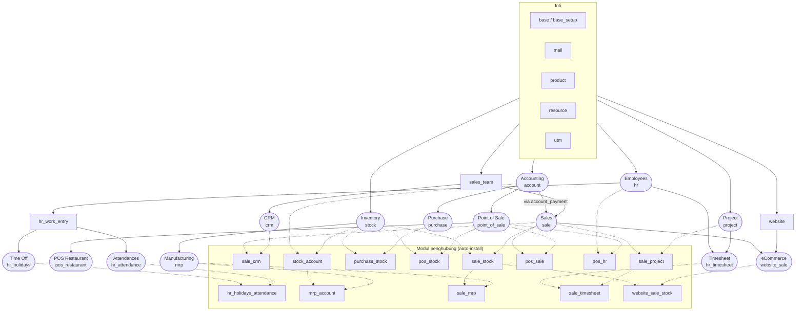

Panah menunjukkan arah dependensi (modul di ujung panah bergantung pada modul di pangkal panah). Modul penghubung seperti `sale_crm` dan `sale_stock` otomatis terpasang jika kedua modul yang dihubungkannya sudah ada.

Catatan versi 20.0: `sale`, `purchase`, dan `point_of_sale` **tidak bergantung langsung pada `stock`**. Integrasi stok selalu lewat modul penghubung (`sale_stock`, `purchase_stock`, `pos_stock`).

---

_Sumber: dokumentasi_overview_odoo.md §1_
