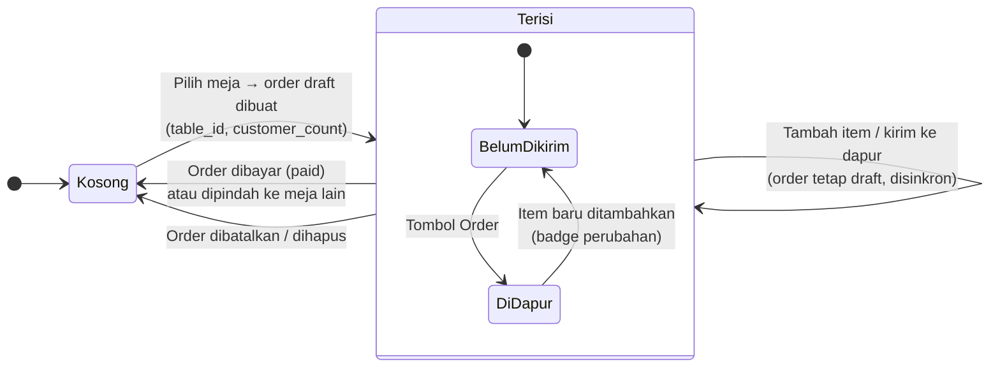

Di server, order restoran yang masih `draft` dicari berdasarkan `uuid` **atau** `table_id` + `state = draft` + `config_id` (`pos.order._get_open_order`). Dengan begitu beberapa perangkat yang membuka meja yang sama memakai order yang sama.

---

_Sumber: dokumentasi_pos_restaurant_odoo.md §5_
