Di Odoo 20.0, `point_of_sale` **tidak lagi bergantung pada `stock`**. Integrasi persediaan (picking, lot/serial) dipisah ke modul `pos_stock`. Fitur lain (restoran, loyalty, self order, payment terminal) juga berupa modul tambahan.

```mermaid
flowchart LR
    subgraph DEP["Dependensi (depends)"]
        direction TB
        resource
        product
        account
        barcodes_gs1_nomenclature
        html_editor
        digest
        phone_validation
        google_address_autocomplete
        base_report_wkhtmltox
        iot_webserial
    end

    POS(["point_of_sale<br/>Checkout & pembayaran<br/>toko dan restoran"])

    subgraph EXT["Modul yang memperluas POS"]
        direction TB
        pos_stock["pos_stock<br/>Picking & stok"]
        pos_restaurant["pos_restaurant<br/>Meja, floor, split bill"]
        pos_hr["pos_hr<br/>Login karyawan / PIN"]
        pos_loyalty["pos_loyalty<br/>Promo, kupon, gift card"]
        pos_self_order["pos_self_order<br/>Kiosk & QR menu"]
        pos_sale["pos_sale<br/>Ambil Sales Order di POS"]
        pos_discount["pos_discount<br/>Diskon global"]
        pos_online_payment["pos_online_payment"]
        terminal["pos_adyen / pos_stripe / pos_razorpay /<br/>pos_mercado_pago / pos_viva_com / ...<br/>Payment terminal"]
        pos_mrp["pos_mrp / pos_repair / pos_event"]
    end

    DEP --> POS
    POS --> EXT
```

---

_Sumber: dokumentasi_pos_odoo.md §1_
