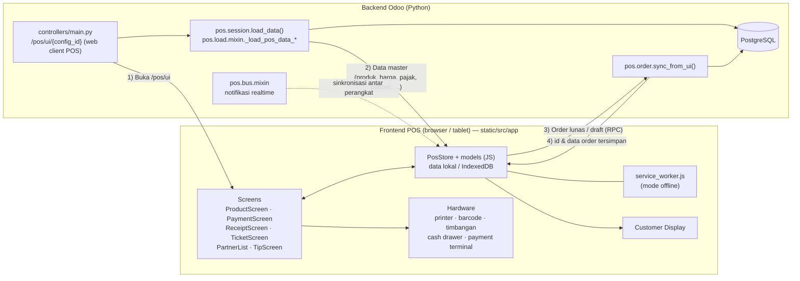

UI kasir adalah aplikasi **OWL (JavaScript)** di `static/src/app`, berjalan di browser dan bisa bekerja **offline**. Saat dibuka, semua data master dimuat sekali lewat `pos.session.load_data()`. Setiap model yang ikut dimuat mewarisi `pos.load.mixin`. Order disimpan lokal (IndexedDB) lalu dikirim ke server lewat `pos.order.sync_from_ui()`. Notifikasi antar-perangkat memakai bus (`pos.bus.mixin`).

---

_Sumber: dokumentasi_pos_odoo.md §2_
