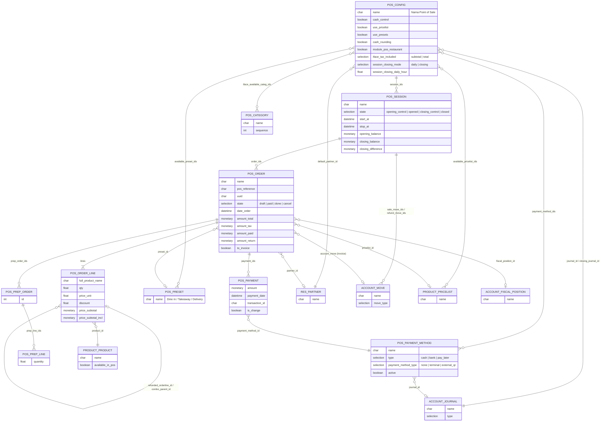

**Model pendukung lain:** `pos.bill` (pecahan uang untuk hitung kas), `pos.note` (catatan cepat), `pos.printer` (printer dapur/struk), `pos.snooze` (produk sementara tidak tersedia), `pos.bus.mixin`, `pos.load.mixin`.

**Model wizard (TransientModel):**

| Model | File | Fungsi |
|---|---|---|
| `pos.make.payment` | `wizard/pos_payment.py` | Input pembayaran order dari backend |
| `pos.make.invoice` | `wizard/pos_make_invoice.py` | Membuat invoice untuk order |
| `pos.details.wizard` | `wizard/pos_details.py` | Laporan Sales Details |
| `pos.daily.sales.reports.wizard` | `wizard/pos_daily_sales_reports.py` | Laporan penjualan harian per sesi |
| `pos.price.inclusion.wizard` | `wizard/pos_price_inclusion_wizard.py` | Pilih harga termasuk/tidak termasuk pajak saat POS pertama dibuka |
| `pos.confirmation.wizard` | `wizard/pos_confirmation_wizard.py` | Dialog konfirmasi umum |

---

_Sumber: dokumentasi_pos_odoo.md §3_
