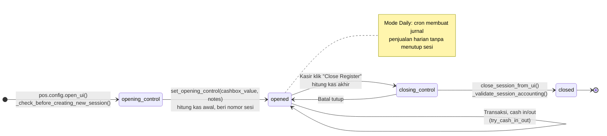

Validasi sebelum membuat sesi baru (`_check_before_creating_new_session`): chart of accounts perusahaan, pricelist, mata uang, jurnal selisih kas (profit/loss), dan metode pembayaran.

---

_Sumber: dokumentasi_pos_odoo.md §4_
