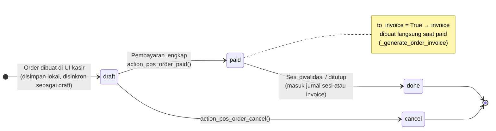

| State | Label | Arti |
|---|---|---|
| `draft` | New | Order belum lunas (mis. meja restoran yang masih terbuka) |
| `paid` | Paid | Sudah lunas, belum ada jurnal akuntansi sesi |
| `done` | Posted | Sudah tercatat di jurnal akuntansi |
| `cancel` | Cancelled | Dibatalkan |

---

_Sumber: dokumentasi_pos_odoo.md §5_
