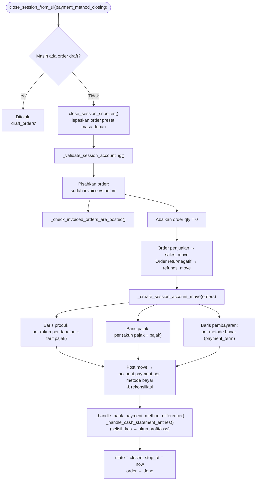

Di Odoo 20.0, penutupan sesi membuat **dokumen penjualan ringkasan** (move tipe `out_invoice`, atau `out_refund` untuk retur) di **Closing Journal** dengan partner **Default Customer** dari konfigurasi POS. Order yang sudah di-invoice per customer tidak ikut dimasukkan.

**Closing Mode** (`session_closing_mode`):

- **Daily**: cron `_cron_generate_invoice_period` (tiap 10 menit) menjalankan `_validate_session_accounting()` sekali sehari pada jam `session_closing_daily_hour` (default 04:00) untuk sesi yang belum ditutup.
- **At closing**: jurnal dibuat saat sesi ditutup.

---

_Sumber: dokumentasi_pos_odoo.md §9_
